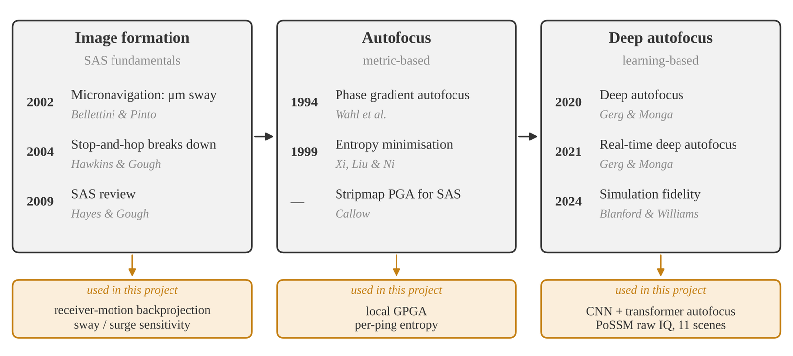
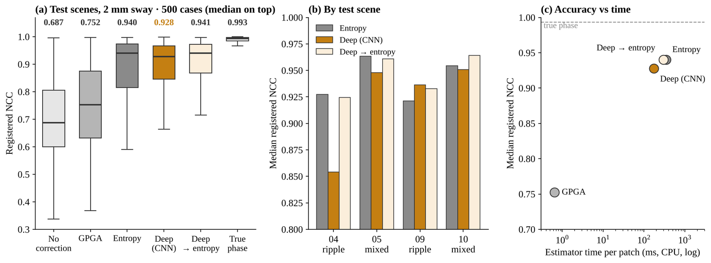

---
# 프로젝트 글입니다. 본문은 일반 Markdown입니다.
# 그림: 같은 폴더에 이미지를 넣고  형식으로 씁니다.
title: "Synthetic Aperture Sonar Imaging and Navigation-Error Sensitivity"
subtitle: "공개 SAS 시뮬레이션 원시 신호로 영상 형성 · 항법 오차 보정을 구현하고, 딥러닝 보정과 기존 방법을 기준 영상으로 비교한 벤치마크"
kind: "능동 소나 · 원시 신호"
order: 3
summary: "원시 신호부터 역투영 영상까지 직접 구현하고, 항법 오차가 영상에 주는 영향과 지표 기반 · 딥러닝 보정의 효과를 기준 영상으로 측정했습니다."
result: "수신기 이동 보상으로 위치 오차 15.1 → 1.8 mm. 좌우 2 mm 항법 오차만으로 영상 일치도 0.50. 해저면 딥러닝 보정은 엔트로피와 같은 정확도(0.93 vs 0.94)를 절반 시간에 냄."
repo: "https://github.com/jongchan-joseph-lee/SAS_signal_processing"
cover: "./sas_scene_comparison.png"
coverAlt: "기준 영상, 직접 만든 역투영 영상, 항법 오차를 넣은 영상 비교"
updated: 2026-11-10
---

공개 합성개구 소나(SAS) 시뮬레이션의 원시 신호로 영상 형성과 항법 오차 보정을 직접 구현하고, 기준 영상과 비교해 항법 오차의 영향과 딥러닝 보정(deep autofocus)의 효과를 측정한 벤치마크

 · 직접 만든 역투영 영상 · 좌우 2 mm 항법 오차")

## Background

| 영상 형성의 전제 | 근거 |
|---|---|
| 정지 가정은 저속 · 짧은 펄스에서만 성립 | Hawkins & Gough (2004) |
| 핑 간 좌우 위치를 수십 μm 수준으로 알아야 함 | Bellettini & Pinto (2002) |
| 위상 오차는 PGA · 엔트로피 최소화로 보정 | Wahl 등 (1994) · Xi, Liu & Ni (1999) |
| 흐린 영상에서 위상 오차를 바로 추정하는 딥러닝 보정 | Gerg & Monga (2020; 2021) |

## Benchmark Setup

| 항목 | 내용 |
|---|---|
| 자료 | PoSSM (MGDS) · 11장면 · 원시 IQ + 기준 영상 · 무잡음 시뮬레이션 |
| 영상 형성 | 정합필터 → 송수신 분리 역투영, 정지 가정 vs 수신기 이동 반영 |
| 항법 오차 | 처리용 항적에 진행 · 좌우 오차와 음속 편향을 넣어 민감도 측정 |
| 보정 | local GPGA · 핑별 엔트로피 최소화 · 딥러닝 보정(CNN + transformer) |
| 딥러닝 보정 자료 | 해저면 0.4 m 조각 · 학습 4장면 → 검증 2장면 → 시험 4장면 (장면 단위 분리) |
| 지표 | 산란체 위치 오차(mm) · 기준 영상과의 복소 상관(NCC) · 진행 방향 평행이동을 맞춘 NCC(registered NCC) |
| 평가 규칙 | 개발 · 검증 자료로 조건을 정한 뒤 시험 자료로 1회 평가 |

## Results

| 비교 | 결과 |
|---|---|
| 정지 가정 vs 수신기 이동 반영 | 위치 오차 15.1 → 1.8 mm |
| 항법 오차 민감도 (2 mm RMS) | 좌우 NCC 0.50 · 진행 방향 0.99 |
| 항법 오차 보정, 고립점 (평행이동 정렬 NCC) | 보정 없음 0.741 → GPGA 0.991 · 엔트로피 0.993 (정답 위상 0.993) |
| 딥러닝 보정, 해저면 시험 500건 | CNN 0.928 · 엔트로피 0.940 (차이 통계적으로 없음) · 처리 시간 약 1/2 |

### 영상 형성

")

처리 설정 (보간 · 창 · PSF)

")

### 항법 오차 민감도

와 음속 편향에 따른 영상 일치도 (24점 × 5경로)")

| 2 mm RMS 오차 | 진행 방향 | 좌우 방향 |
|---|---|---|
| 기준 영상 NCC | 0.99 | 0.50 |

### 항법 오차 보정

. 같은 보정 결과에 지표만 다르게 적용")

| 엔트로피 보정 | 15–35 m | 35–55 m | 55–80 m |
|---|---|---|---|
| 기존 NCC | 0.977 | 0.726 | 0.594 |
| 평행이동 정렬 NCC | 0.994 | 0.993 | 0.991 |

- 핑 간 선형 위상 = 진행 방향 평행이동 → 기준 없는 보정으로는 복원 불가
- 먼 거리 효과 감소는 보정 실패가 아니라 지표에 섞인 평행이동

### 딥러닝 보정 (deep autofocus)

: 핑별 위상 · 진폭 관계 → CNN → transformer → 위상 갱신, 8회 반복")

| 구분 | 내용 |
|---|---|
| 학습 | 거친 해저면 4장면 600조각 · 오차 없는 조각에 핑별 위상 오차 합성 (Gerg & Monga 방식) |
| 시험 | 학습에 없던 물결 · 혼합 해저면 4장면 · 100조각 × 5경로 · 처리용 항적에 2 mm 좌우 오차 |

| 방법 | NCC 중앙값 | 하위 10% | 오차 없는 입력 손실 | 처리 시간 |
|---|---|---|---|---|
| GPGA | 0.752 | 0.563 | 0.144 | 0.6 ms |
| 엔트로피 | 0.940 | 0.706 | 0.038 | 345 ms |
| **CNN** | **0.928** | **0.721** | **0.021** | **173 ms** |
| CNN → 엔트로피 | 0.941 | 0.720 | 0.038 | 296 ms |
| 정답 위상 | 0.993 | – | 0 | – |

- CNN − 엔트로피: −0.006 (95% CI −0.014–0.002) → 차이 없음, 처리 시간 절반
- 물결 해저면 scene04: CNN 0.854 vs 엔트로피 0.927 → 학습에 없던 해저 유형에서 약함

: 기준 · 오차 · 엔트로피 · CNN")

부록: 객체 탐지 시도 (사전 기준 미달)

| 시험 4장면 · 물체 36개 | 재현율 | 장면당 오경보 |
|---|---|---|
| 후보 생성 + Random Forest | 0.25 (9/36) | 2.75 |

## Takeaways

- 수신기 이동 반영\
  → 정지 가정 대비 위치 오차 약 1/8 (15.1 → 1.8 mm). mm급 영상 형성의 전제 조건
- 항법 오차의 영향\
  → 좌우 방향 mm 단위 오차가 영상 품질을 좌우함. 미세항법 정확도 요구(Bellettini & Pinto, 2002)를 수치로 확인
- 보정 평가 지표\
  → 평행이동을 맞춰 비교하면 고립점 보정은 거리와 무관하게 정답 위상 수준
- 딥러닝 보정\
  → 해저면에서 엔트로피와 같은 정확도를 약 절반의 처리 시간으로 냄. 정확도 우위는 확인되지 않음

## Limitations → Next Steps

- 학습에 없던 해저 유형(물결)에서 CNN 성능 저하\
  → 해저 유형을 섞어 학습, 장면 수 확대
- 오차 없는 입력도 보정 후 영상이 달라짐\
  → 오차 크기를 먼저 추정해 보정 여부 결정, 오차 없는 입력의 손실을 학습 목표에 포함
- 모든 방법이 정답 위상과 0.05 이상 차이\
  → 큰 조각 · 장면 전체 보정, 공간 가변 오차 추정으로 확장
- 처리 시간이 CPU 2코어 기준\
  → GPU 일괄 추론으로 실시간성 평가 (Gerg & Monga, 2021)
- 무잡음 시뮬레이션 한 종류\
  → 잡음을 넣은 시뮬레이션으로 재평가 후 실측 SAS로 확장. 시뮬레이션 자료의 충실도 문제(Blanford & Williams, 2024) 고려
- 항법 오차를 원시 신호가 아닌 처리용 항적에 넣어 생성\
  → 원시 신호 단계에서 항법 오차를 넣은 시뮬레이션으로 검증

[저장소 · 참고문헌](https://github.com/jongchan-joseph-lee/SAS_signal_processing) · [보고서](https://github.com/jongchan-joseph-lee/SAS_signal_processing/blob/main/report_v3/report.html)
