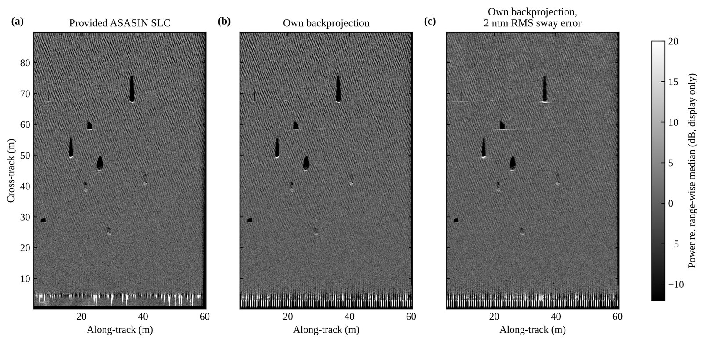

---
# 프로젝트 글입니다. 본문은 일반 Markdown입니다.
# 그림: 같은 폴더에 이미지를 넣고  형식으로 씁니다.
title: "합성개구 소나 원시 신호의 영상 형성 · 보정 · 탐지"
subtitle: "공개 합성 SAS(PoSSM) 원시 IQ에서 정합필터 → 역투영 → autofocus → 탐지까지 직접 구현"
kind: "능동 소나 · 원시 신호"
order: 3
summary: "공개 SAS 시뮬레이션 원시 신호로 영상 형성부터 탐지까지 구현하고, 각 단계를 기준 영상과 사전에 정한 기준으로 검증했습니다."
result: "수신기 이동을 반영해 산란체 위치 오차 중앙값을 15.1 mm에서 1.8 mm로 줄였고, 기준에 못 미친 보정 · 탐지 결과도 그대로 남겼습니다."
repo: "https://github.com/jongchan-joseph-lee/SAS_signal_processing"
cover: "./sas_scene_comparison.png"
coverAlt: "기준 영상, 직접 만든 역투영 영상, 항법 오차를 넣은 영상 비교"
updated: 2026-11-09
---

공개 합성개구 소나(Synthetic Aperture Sonar, SAS) 시뮬레이션 자료(PoSSM)의 원시 신호(raw IQ)로 영상 형성, 항법 오차 보정, 객체 탐지를 직접 구현하고 기준 영상과 비교해 검증한 프로젝트입니다.

## Overview

- **문제**: 공개 SAS 자료는 대부분 처리된 영상만 제공해 처리 체인 자체를 검증하기 어렵습니다. PoSSM은 원시 신호, 기준 영상(ASASIN SLC), 산란체 · 객체 정답 위치를 함께 제공합니다.
- **방법**: 정합필터 → 송수신 분리(bistatic) 역투영 → 항법 오차 보정(local GPGA, 핑별 엔트로피 최소화) → 후보 생성 + Random Forest 탐지. 보정과 탐지는 개발용 자료로 조건과 성공 기준을 정한 뒤 시험 자료로 한 번 평가했습니다.
- **결과**: 수신기 이동을 반영해 산란체 위치 오차를 15.1 mm에서 1.8 mm로 줄였고, 처리 설정으로 기준 영상과의 일치도(complex NCC)를 0.672에서 0.875로 높였습니다. 보정과 탐지는 사전 기준에 미달해 채택하지 않았습니다.

## Results

| 단계 | 결과 | 사전 기준 |
|---|---|---|
| 수신기 이동 반영 | 위치 오차 중앙값 15.1 → 1.8 mm | — |
| 처리 설정 (Hann + Gaussian) | 기준 영상 NCC 0.672 → 0.875 | — |
| 항법 오차 민감도 | 좌우 2 mm RMS에서 NCC 0.50 (진행 방향 0.99) | — |
| 항법 오차 보정 (핑별 엔트로피) | NCC 0.442 → 0.830 | 0.90 미달, 미채택 |
| 객체 탐지 | 재현율 0.25 (36개 중 9개), 장면당 오경보 2.75 | 0.8 미달, 미채택 |

영상 형성 · 처리 설정

과 수신기 이동 반영 모델의 위치 오차 (산란체 24개)")

")

항법 오차 민감도

와 음속 편향에 따른 영상 일치도 (24점 × 5경로)")

객체 탐지

- 처리 설정 후 기준 영상과의 일치도가 오른 것(0.672 → 0.875)은 기준 영상이 비슷한 창 처리를 거쳤을 가능성을 시사하며, 영상 품질이 좋아졌다는 뜻은 아닙니다. 창 적용으로 주엽은 넓어졌습니다(진행 방향 3 dB 폭 24.4 → 26.8 mm).
- 보정 효과는 거리가 멀수록 줄었습니다: NCC 0.977 (15–35 m), 0.726 (35–55 m), 0.594 (55–80 m).
- 결과 수치: [`results/v2/`](https://github.com/jongchan-joseph-lee/SAS_signal_processing/tree/main/results/v2/), [`results/v3/`](https://github.com/jongchan-joseph-lee/SAS_signal_processing/tree/main/results/v3/) · 사전 고정 조건: [`results/v3/protocol.json`](https://github.com/jongchan-joseph-lee/SAS_signal_processing/blob/main/results/v3/protocol.json) · 보고서: [`report_v3/report.html`](https://github.com/jongchan-joseph-lee/SAS_signal_processing/blob/main/report_v3/report.html)

## Next Steps

1. 먼 거리(35 m 이상)에서 보정 효과가 줄어드는 원인 분석
2. 잡음을 넣은 시뮬레이션으로 같은 처리 순서 재평가, 이후 실측 SAS 자료로 확장
3. 기준 영상과 장면 전체 차이를 만드는 처리 단계(거리별 진폭 규약, 보간, 창) 분리

## Dataset

- [PoSSM simulated SAS data package](https://doi.org/10.60521/331898) (Philtron, Johnson & Brown, MGDS, CC BY-NC-SA 3.0 US) — 11장면, 원시 GDF와 복소 기준 영상(SLC)
- 무잡음 시뮬레이션이며, 장면 속 객체는 통발 · 암석 · 원통입니다(실제 기뢰 아님).
- 원자료(약 2.4 GB)는 저장소에 포함하지 않으며 실행 시 내려받습니다.

## Limitations

- 무잡음 시뮬레이션 자료 한 종류의 결과입니다. 실측 SAS, 잡음 환경, 실제 기뢰는 다루지 않았습니다.
- 항법 오차는 원시 신호가 아닌 처리용 가정 항적을 바꿔 만들었습니다.
- 탐지 시험은 4장면 36개 객체로 표본이 작습니다.
