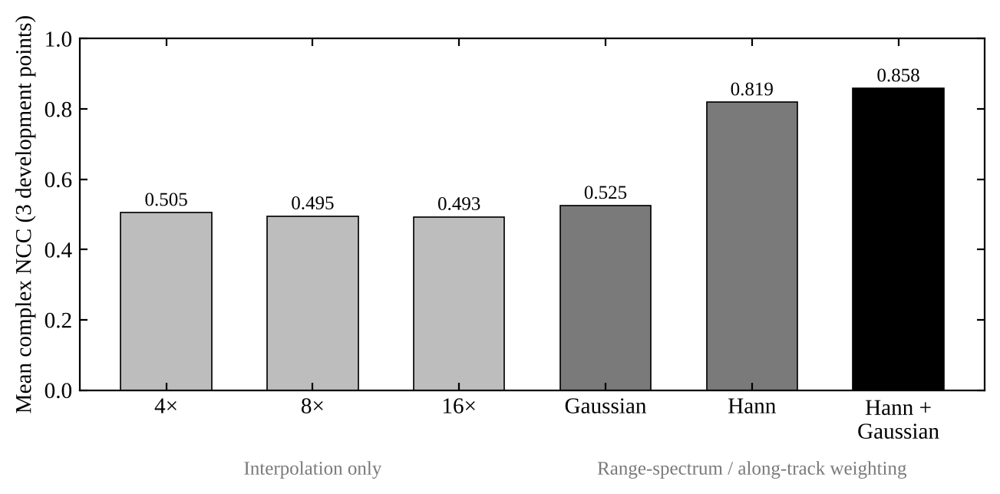
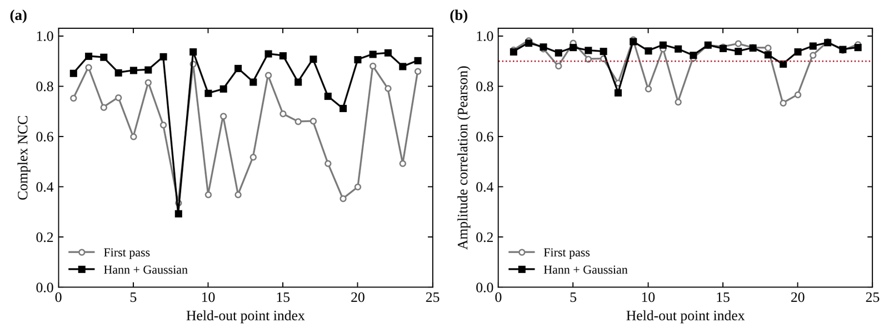
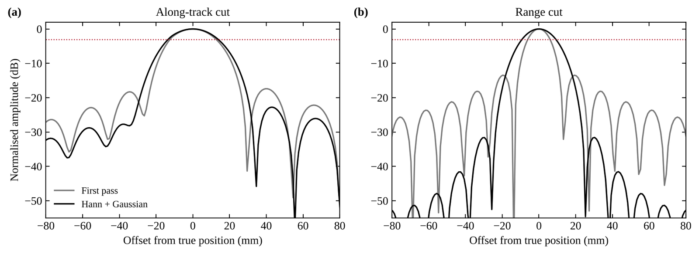
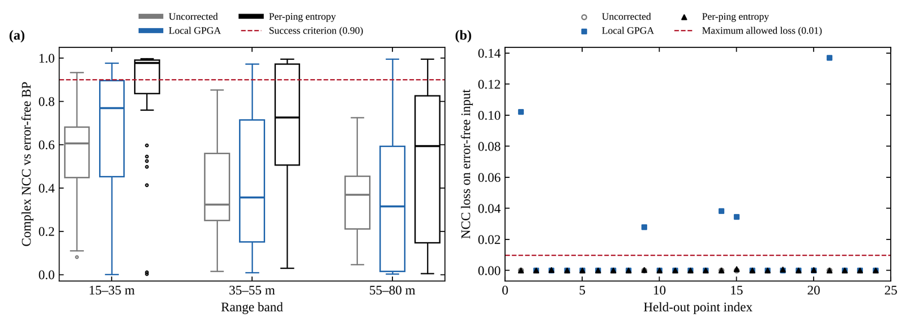
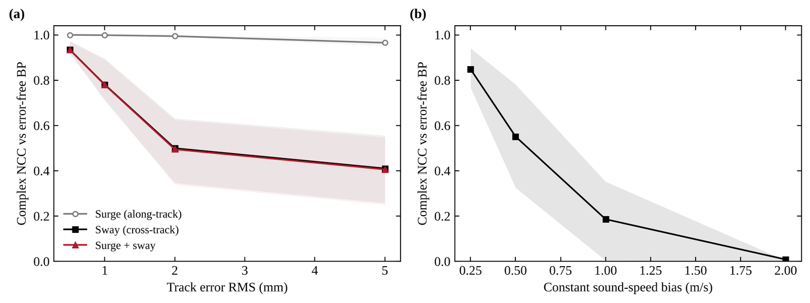
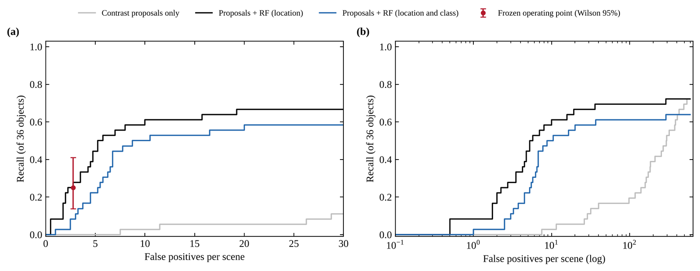
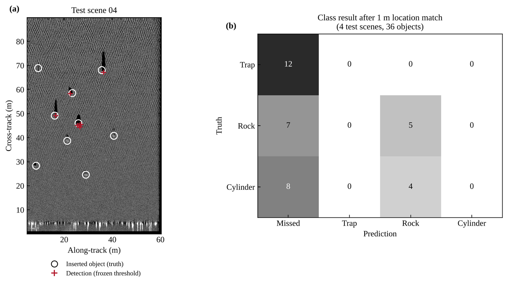

---
# 프로젝트 글입니다. 본문은 일반 Markdown입니다.
# 그림: 같은 폴더에 이미지를 넣고  형식으로 씁니다.
title: "합성개구 소나 원시 신호의 영상 형성 · 보정 · 탐지"
subtitle: "공개 합성 SAS(PoSSM) 원시 IQ에서 정합필터 → 역투영 → autofocus → 탐지까지 직접 구현"
kind: "능동 소나 · 원시 신호"
order: 3
summary: "공개 SAS 시뮬레이션 원시 신호로 영상 형성부터 탐지까지 구현하고, 각 단계를 기준 영상과 사전에 정한 기준으로 검증했습니다."
result: "수신기 이동을 반영해 산란체 위치 오차 중앙값을 15.1 mm에서 1.8 mm로 줄였고, 기준에 못 미친 보정 · 탐지 결과도 그대로 남겼습니다."
repo: "https://github.com/jongchan-joseph-lee/SAS_signal_processing"
cover: "./sas_scene_comparison.png"
coverAlt: "기준 영상, 직접 만든 역투영 영상, 항법 오차를 넣은 영상 비교"
updated: 2026-11-09
---

공개 합성개구 소나(Synthetic Aperture Sonar, SAS) 시뮬레이션의 원시 신호로 영상 형성 · 항법 오차 보정 · 탐지를 직접 구현하고 기준 영상과 비교한 프로젝트입니다.

 · 직접 만든 역투영 영상 · 좌우 2 mm 항법 오차")

| 항목 | 내용 |
|---|---|
| 자료 | PoSSM (MGDS) · 11장면 원시 IQ + 복소 기준 영상 · 무잡음 시뮬레이션 |
| 처리 | 정합필터 → 송수신 분리 역투영 → autofocus (local GPGA) → 후보 + Random Forest |
| 검증 | 기준 영상 complex NCC · 개발용 자료로 정한 사전 기준 |

## 단계별 결과

| 단계 | 결과 | 사전 기준 |
|---|---|---|
| 수신기 이동 반영 | 위치 오차 15.1 → 1.8 mm | — |
| 처리 설정 (Hann + Gaussian) | NCC 0.672 → 0.875 | — |
| 항법 오차 민감도 | 좌우 2 mm RMS에서 NCC 0.50 | — |
| 항법 오차 보정 | NCC 0.442 → 0.830 | 0.90 미달 |
| 객체 탐지 | 재현율 0.25 (9/36), 장면당 오경보 2.75 | 0.8 미달 |

## 영상 형성

")

- NCC 상승(0.672 → 0.875)은 기준 영상의 창 처리와 비슷해진 결과 (주엽은 24.4 → 26.8 mm로 넓어짐)

처리 설정 (보간 · 창 · PSF)

## 항법 오차 보정

| 거리 | 15–35 m | 35–55 m | 55–80 m |
|---|---|---|---|
| 보정 후 NCC | 0.977 | 0.726 | 0.594 |

항법 오차 민감도

## 탐지

탐지 예시

## 다음 단계

- 먼 거리(35 m 이상) 보정 저하 원인 분석
- 잡음 시뮬레이션 → 실측 SAS
- 기준 영상과의 장면 차이를 처리 단계별로 분리

## 한계

- 무잡음 시뮬레이션 한 종류 · 실제 기뢰 아님
- 항법 오차는 처리용 가정 항적을 바꿔 생성
- 탐지 시험 4장면 · 물체 36개

[결과 수치](https://github.com/jongchan-joseph-lee/SAS_signal_processing/tree/main/results) · [보고서](https://github.com/jongchan-joseph-lee/SAS_signal_processing/blob/main/report_v3/report.html)
