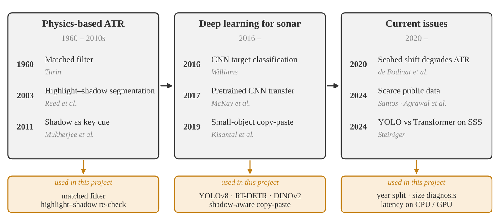
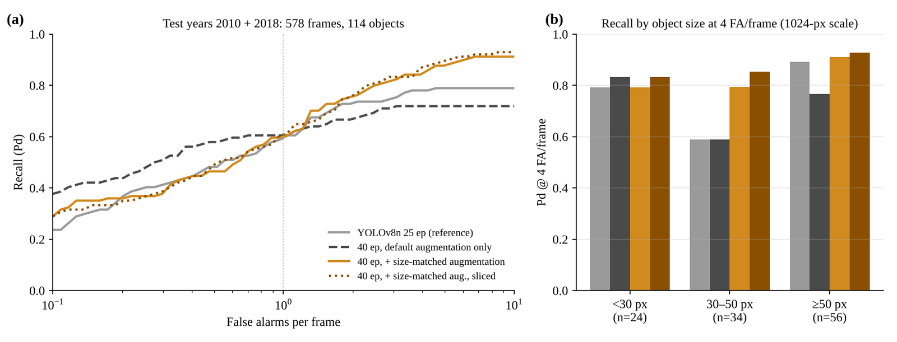
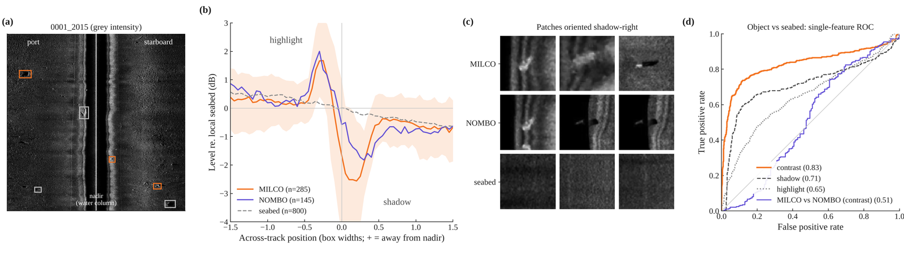
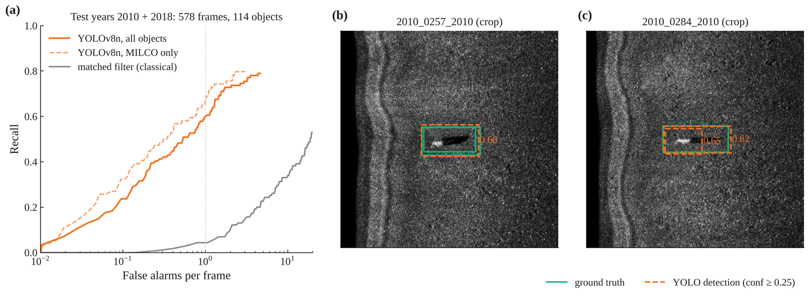
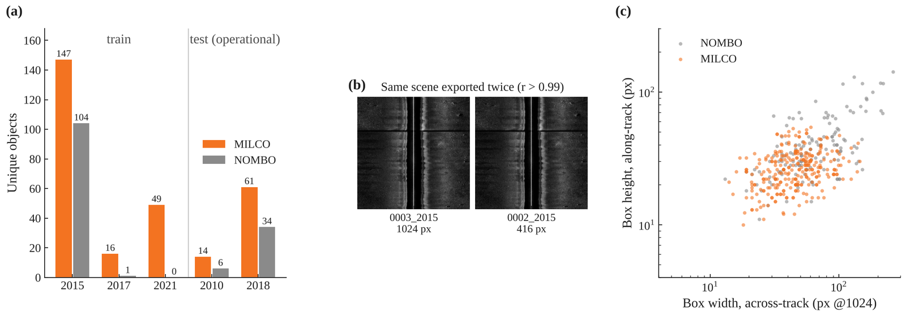

---
# 프로젝트 글입니다. 본문은 일반 Markdown입니다.
# 그림: 같은 폴더에 이미지를 넣고  형식으로 씁니다.
title: "AI-based Side-Scan Sonar Mine Detection Benchmark"
subtitle: "공개 AUV 측면주사 소나 영상에서 AI 탐지기를 미학습 촬영 연도로 비교한 벤치마크"
kind: "능동 소나 · 영상"
order: 2
summary: "정합필터 · YOLOv8 · RT-DETR 탐지기를 학습에 쓰지 않은 촬영 연도에서 비교하고, 크기 맞춤 증강과 물리 특징 재판정의 효과를 측정했습니다."
result: "크기 맞춤 증강으로 탐지율 +13%p. 모델을 키워도 탐지율은 같고 CPU 추론만 14배 느려져, 탑재용으로는 경량 모델(3.1 M)이 적합."
repo: "https://github.com/jongchan-joseph-lee/sss-mine-detection-benchmark"
cover: "./sss_augmentation_froc.png"
coverAlt: "원본 · 증강 학습의 시험 연도 FROC와 물체 크기별 Pd"
updated: 2026-11-10
---

공개 AUV 측면주사 소나(SSS) 영상에서 AI 탐지기로 기뢰유사물체를 찾고, 학습에 쓰지 않은 촬영 연도로 성능을 비교한 벤치마크

## Background

| 운용의 걸림돌 | 근거 |
|---|---|
| 공개 실측 자료 부족 | Santos 등 (2024) |
| 작은 표적의 오경보 | Cui 등 (2025) |
| 해역 · 조사 조건이 바뀔 때의 성능 저하 | de Bodinat 등 (2020) |

## Benchmark Setup

 · 시험(분할 추론) → 평가")

| 항목 | 내용 |
|---|---|
| 자료 | Santos 등 (2024), AUV SSS JPEG 1,170장 · MILCO / NOMBO |
| 분할 | 학습 2015 · 2017 · 2021 → 시험 2010 · 2018 (영상 578장, 물체 114개) |
| 탐지기 | 정합필터 · YOLOv8n · YOLOv8s · RT-DETR-l |
| 학습 자료 | 기본 증강만 / + 크기 맞춤 증강 |
| 보조 | 하이라이트–그림자 물리 특징 재판정 |
| 지표 | 영상당 평균 오경보 수(FA/image)별 탐지율 Pd · CPU / GPU 추론 시간 |

## Results

| 비교 | 결과 |
|---|---|
| AI 탐지기 vs 정합필터 | Pd 59.6% vs 4.3% (FA/image 1) |
| 크기 맞춤 증강 | Pd +13%p (FA/image 8), 30–50 px 표적 59% → 79% |
| 모델 규모 (3.1 → 32.8 M) | Pd 같음, CPU 추론 132 ms → 1,816 ms |
| 물리 특징 재판정 | Pd 59.6% → 70.2% (FA/image 1) |

### 크기 맞춤 증강

 원본 · (b) 축소 · (c) 다른 연도 해저면에 그림자째 합성 · (d) 광도 증강")

| Pd (YOLOv8n) | FA/image 4 | 8 | 30–50 px |
|---|---|---|---|
| 기본 증강만 | 71.9% | 71.9% | 58.8% |
| + 크기 맞춤 증강 | 84.2% | 91.2% | 79.4% |

시험 연도 FROC · 크기별 Pd

### 모델 규모와 추론 시간

 vs 영상 1장당 추론 시간 (분할 추론, RTX 3070 Ti PC)")

| + 크기 맞춤 증강 | 파라미터 | Pd @ 8 | CPU | GPU |
|---|---|---|---|---|
| YOLOv8n | 3.1 M | 86.8% | 132 ms | 20 ms |
| YOLOv8s | 11.1 M | 85.1% | 325 ms | 29 ms |
| RT-DETR-l | 32.8 M | 78.9% | 1,816 ms | 97 ms |

모델 구조

 YOLOv8n 탐지기 · (b) 하이라이트–그림자 재판정 분류기")

### 하이라이트–그림자 물리 특징 재판정

| Pd | FA/image 0.5 | 1 |
|---|---|---|
| YOLOv8n 단독 | 48.2% | 59.6% |
| + 물리 특징 재판정 | 53.5% | 70.2% |

탐지 기준선 · 자료 점검

## Takeaways

- 탐지 성능의 결정 요인\
  → 모델 크기보다 학습 자료의 표적 크기 분포
- 탑재용 모델 선택\
  → 경량 모델(YOLOv8n, 3.1 M): Pd 동등, CPU 추론 14배 빠름
- 하이라이트–그림자 물리 특징\
  → AI 탐지기 오경보 저감용 보조 판정

## Limitations → Next Steps

- 고정 분할 1개 · 학습 1회 (재학습 시 Pd 약 9%p 차이)\
  → 연도 단위 교차검증(leave-one-year-out)과 반복 실행으로 평균 ± 표준편차 보고
- 영상 단위 무작위 k-fold 불가 (같은 장면 축소 복사본 417쌍으로 누수 발생)\
  → 장면 · 연도 단위 그룹 분할(group k-fold)
- 연도마다 해저 · 장비 설정 · 해상도 · 표적 구성이 함께 바뀌어 원인 특정 곤란\
  → 연도별 성능 분리 보고, 표적 크기 · 해저 유형별 요인 분석
- 시험 물체 114개 중 94개가 2018년에 편중 (95% CI 약 ±9%p)\
  → 교차검증으로 모든 연도를 한 번씩 시험
- 증강 방향을 시험 연도 진단을 보고 설정 (효과 과대 추정 가능)\
  → 교차검증에서는 학습 연도 정보만으로 증강 범위 설정
- 검증 장면 26장으로 epoch · 임계값 선택 불안정\
  → 고정 epoch 사용, 교차검증 fold 단위로 임계값 설정
- JPEG 입력 · 단일 장비 계열 · 면적당 오경보 환산 정보 없음\
  → 원시 신호 · 메타데이터(거리 설정 · 픽셀 크기)가 있는 자료로 확장

[저장소 · 참고문헌](https://github.com/jongchan-joseph-lee/sss-mine-detection-benchmark) · [실행 기록](https://github.com/jongchan-joseph-lee/sss-mine-detection-benchmark/tree/main/src/gpu_runs)
