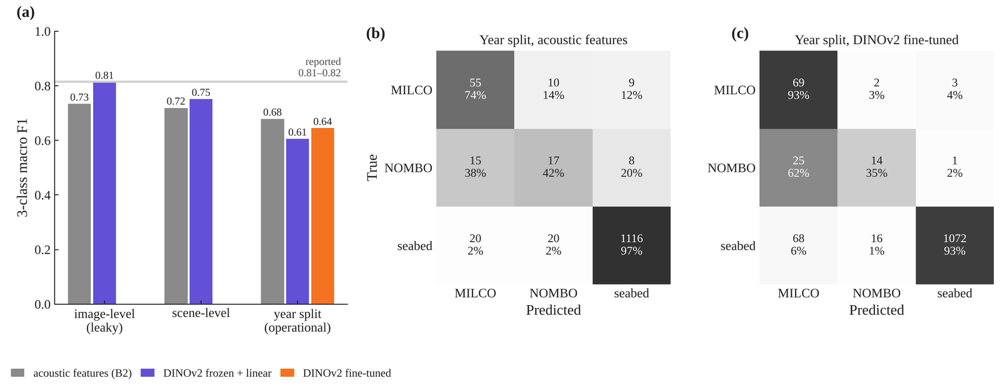

---
# 프로젝트 글입니다. 본문은 일반 Markdown입니다.
# 그림: 같은 폴더에 이미지를 넣고  형식으로 씁니다.
title: "측면주사 소나 기뢰유사물체 탐지 · 분류 평가"
subtitle: "Side-Scan Sonar 공개 영상에서 중복 장면과 촬영 연도 변화가 평가에 미치는 영향"
kind: "능동 소나 · 영상"
order: 2
summary: "공개 측면주사 소나 영상에서 탐지기와 패치 분류기를 따로 평가하고, 물리 특징과 AI 특징을 같은 분할 규약에서 비교했습니다."
result: "처음 보는 연도에서 YOLOv8n Pd 78.1%(영상당 오경보 4건)를 크기 맞춤 증강으로 87.7%까지 올렸습니다. 정합필터 기준선은 4.3%(오경보 1건)였습니다."
repo: "https://github.com/jongchan-joseph-lee/sss-mine-detection-benchmark"
cover: "./sss_augmentation_froc.png"
coverAlt: "원본 · 증강 학습의 시험 연도 FROC와 물체 크기별 Pd"
updated: 2026-11-09
---

공개 측면주사 소나(Side-Scan Sonar, SSS) 영상에서 기뢰유사물체 탐지기를 촬영 연도 분할로 평가하고 개선한 프로젝트입니다.

 · 시험(분할 추론) · 검증(운영점) → 평가")

| 항목 | 내용 |
|---|---|
| 자료 | Santos et al. 2024 · AUV SSS JPEG 1,170장 (고유 장면 753) · MILCO / NOMBO |
| 분할 | 학습 2015 · 2017 · 2021 → 시험 2010 · 2018 (578장, 물체 114) |
| 탐지기 | YOLOv8n + 크기 맞춤 증강 + 분할 추론 |
| 결과 | Pd 78.1% → 87.7% (영상당 오경보 4건) |

## 탐지

| Pd @ 영상당 오경보 | 0.5 | 1 | 4 | 8 | 30–50 px @ 4 |
|---|---|---|---|---|---|
| 정합필터 (고전) | — | 4.3% | — | — | — |
| YOLOv8n | 48.2% | 59.6% | 78.1% | 78.9% | 58.8% |
| + 크기 맞춤 증강 | 46.5% | 60.5% | 84.2% | 91.2% | 79.4% |
| + 분할 추론 | 50.0% | 60.5% | 87.7% | 93.0% | 85.3% |

- 놓친 물체가 30–50 px에 몰려 있어, 학습 물체를 이 크기로 줄이고 그림자째 붙여 넣어 증강
- 오경보 0.5건 이하 구간은 개선 없음

기존 탐지기 FROC · 탐지 예시

## 모델 구조 · 재판정

 YOLOv8n 탐지기 · (b) 하이라이트–그림자 재판정 분류기")

| Pd @ 영상당 오경보 1건 | 탐지기 단독 | + 재판정 |
|---|---|---|
| 기존 탐지기 | 59.6% | 70.2% |
| 증강 탐지기 | 60.5% | 58.8% |

- 재판정은 기존 탐지기에서만 효과 (증강 후에는 탐지기가 같은 단서를 이미 쓰는 것으로 추정)

## 운영점 이전

| 검증 장면에서 Pd 91%로 정한 임계값 | 시험 연도 Pd | 오경보 / 영상 |
|---|---|---|
| 기존 탐지기 | 57.0% | 0.84 |
| 증강 탐지기 | 84.2% | 3.47 |

## 분류: 물리 특징 vs DINOv2

| 패치 3분류 macro F1 | 이미지 분할 | 장면 분할 | 연도 분할 |
|---|---|---|---|
| 물리 특징 + 로지스틱 회귀 | 0.734 | 0.719 | 0.679 |
| DINOv2 고정 특징 + 선형 분류기 | 0.814 | 0.751 | 0.606 |
| DINOv2 미세조정 | — | — | 0.645 |

- 연도가 바뀔 때 하락폭: 물리 특징 0.04, DINOv2 0.15

분할별 분류 결과 · 자료 점검

면적당 오경보 예시 (가정 조건)

| 가정 | 값 |
|---|---|
| 거리 · 스와스 | 한쪽 50 m · 100 m |
| 픽셀 · 핑 간격 | 0.098 m · 0.1 m (15 Hz, 1.5 m/s) |
| 영상 1장 | ≈ 0.010 km² |

| 영상당 오경보 | 0.5 | 1 | 2 | 4 |
|---|---|---|---|---|
| 면적당 (/km²) | 49 | 98 | 195 | 391 |

공개 자료에 거리 설정 · 픽셀 크기가 없어 다른 연구와 비교할 수 없는 예시입니다.

## 한계

- JPEG 영상 · CPU 학습 소형 모델 · 단일 자료
- 검증 장면 26장 → epoch · 임계값 선택 불안정
- 증강 방향은 시험 연도 진단을 보고 정함

[결과 수치](https://github.com/jongchan-joseph-lee/sss-mine-detection-benchmark/tree/main/src) · [GPU 비교 노트북](https://github.com/jongchan-joseph-lee/sss-mine-detection-benchmark/blob/main/colab/compare_detectors.ipynb)
