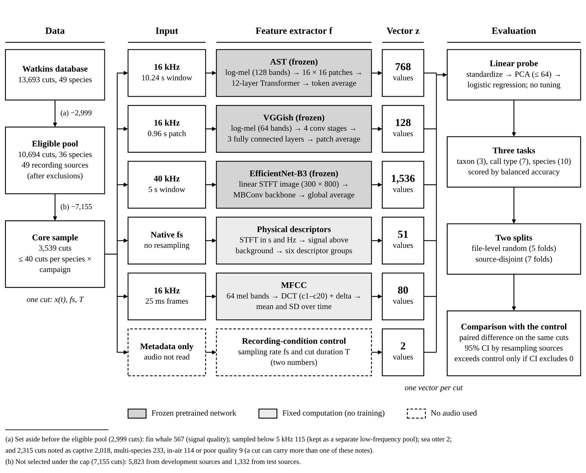

---
# 프로젝트 글입니다. 본문은 일반 Markdown입니다.
# 그림: 같은 폴더에 이미지를 넣고  형식으로 씁니다.
title: "What generalises across recordings?"
subtitle: "Watkins 해양포유류 음향 DB에서 레퍼런스 표현의 일반화 평가"
kind: "수동음향 (PAM)"
order: 1
summary: "공개 해양포유류 음향 DB에서 보고된 높은 종 분류 성능이 녹음 출처를 분리한 평가에서도 유지되는지 검토했습니다."
result: "녹음 출처를 분리하자 종 균형정확도가 0.64–0.76에서 0.21–0.33으로 내려가, 오디오를 읽지 않는 기준선(0.24)과 비슷해졌습니다."
repo: "https://github.com/jongchan-joseph-lee/marine-mammal-classifier-benchmark"
cover: "./pam_balanced_accuracy.png"
coverAlt: "표현별 균형정확도: 클립 무작위 분할과 녹음 출처 분리 비교"
updated: 2026-11-08
---

Watkins 해양포유류 음향 DB에서 사전학습 오디오 모델의 종 분류 성능을 녹음 출처 분리(source-disjoint) 조건으로 다시 평가한 프로젝트입니다.

## Overview

- **문제**: Watkins DB에서 높은 종 분류 성능을 보고한 선행연구들은 대부분 클립 단위 무작위 분할로 평가했습니다. 이 경우 같은 녹음에서 잘린 클립이 학습과 시험에 함께 들어갑니다.
- **방법**: 5개 표현(AST, VGGish, EfficientNet-B3, MFCC, 물리 특징 51개) + linear probe로 무작위 분할과 녹음 출처 분리 분할을 비교하고, 오디오 없이 메타데이터(샘플레이트 · 길이)만 쓴 기준선과 대조했습니다.
- **결과**: 녹음 출처를 분리하면 종 분류 균형정확도(BA)가 0.21–0.33으로 낮아져 메타데이터 기준선(0.24)과 비슷해집니다.

특징 추출기별 처리 예시

## Results

| Balanced accuracy | 무작위 분할 | 녹음 출처 분리 |
|---|---|---|
| 종 (10) | 0.64–0.76 | 0.21–0.33 (기준선 0.24) |
| 콜 타입 (7) | 0.55–0.74 | 0.29–0.48 |
| 분류군 (3) | 0.82–0.93 | 0.63–0.80 |

임베딩 분포 (UMAP · t-SNE)

")

- 녹음 출처가 달라져도 신호 유형(tonal · impulsive · pulsed)과 주파수 대역 기준의 구분은 유지되었습니다 (탐색적 분석).

신호 유형 · 물리량 · 주파수 대역

")

")

")

- AST 부분 미세조정: 전체 BA 0.784 → 0.752. 수염고래 · 이빨고래 재현율은 오르고 기각류는 내려갔습니다 ([결과](https://github.com/jongchan-joseph-lee/marine-mammal-classifier-benchmark/blob/main/results/ast_finetune_results.json)).

## Dataset

- [Watkins Marine Mammal Sound Database](https://whoicf2.whoi.edu/science/B/whalesounds/index.cfm) (WHOI), Earth Species Project 공개본 v0.1.0
- 10,694 클립 (36종, 녹음 출처 49개) → 평가 표본 3,539 클립
- 원음은 저장소에 포함하지 않습니다.

자료 구조

## Limitations

- Watkins DB 내부 평가입니다. 외부 자료, 연속 녹음, 실해역 운용은 다루지 않았습니다.
- 녹음 출처는 메타데이터(지역 + 연도)로 정한 근사 단위입니다.
- 신호 유형 분석은 첫 결과 이후 정의한 탐색적 분석입니다.
