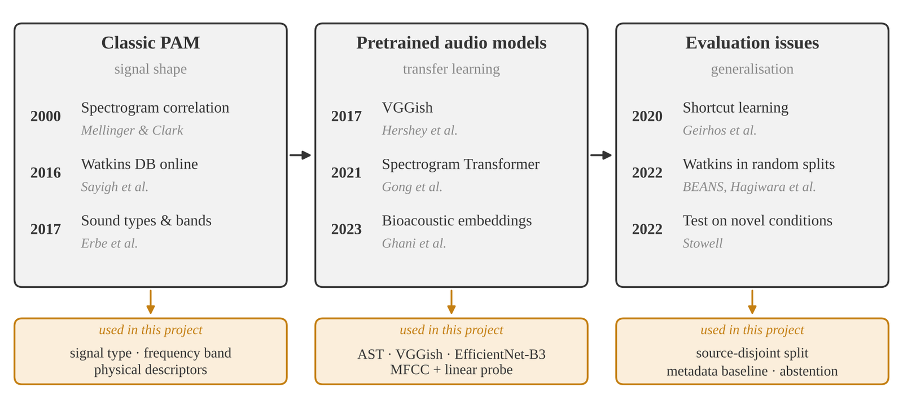
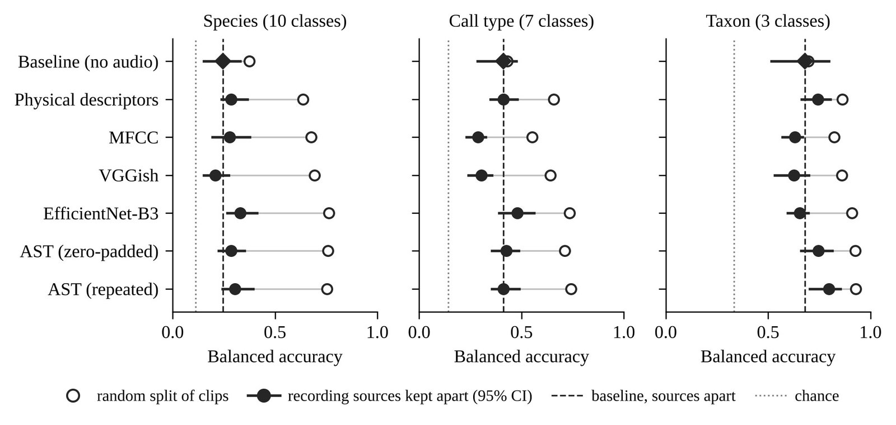
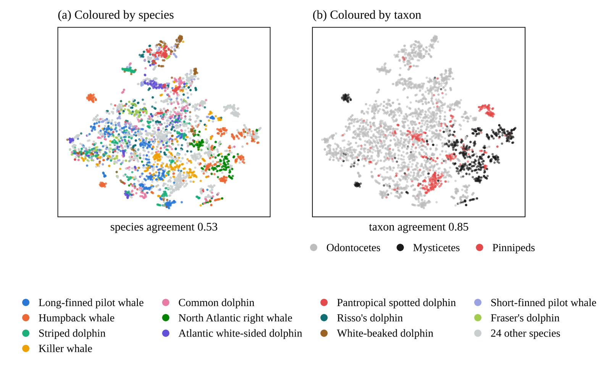
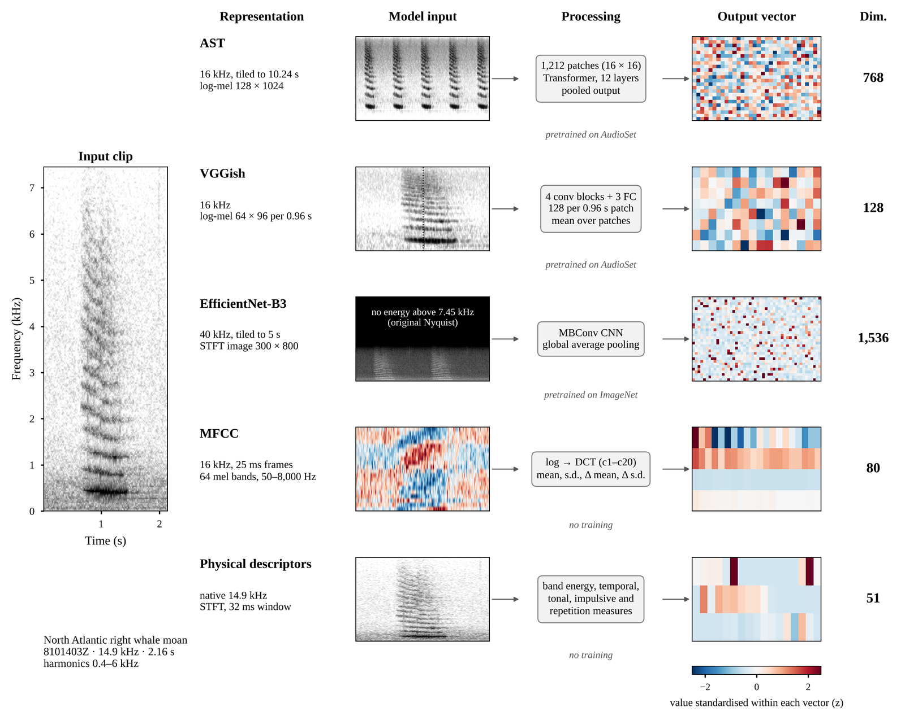
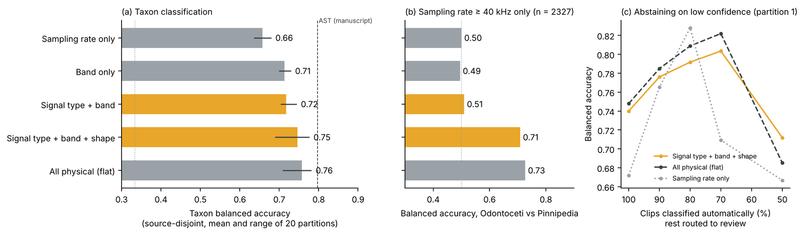
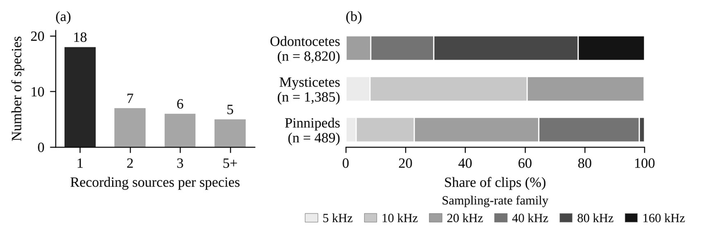

---
# 프로젝트 글입니다. 본문은 일반 Markdown입니다.
# 그림: 같은 폴더에 이미지를 넣고  형식으로 씁니다.
title: "Source-Disjoint Marine Mammal Sound Classification Benchmark"
subtitle: "Watkins 해양포유류 음향 DB에서 녹음 출처를 분리해 사전학습 오디오 표현과 신호 유형 기반 분류기를 비교한 벤치마크"
kind: "수동음향 (PAM)"
order: 1
summary: "높은 종 분류 성능이 녹음 출처를 분리해도 유지되는지 검토하고, 녹음이 바뀌어도 유지되는 신호 유형 · 주파수 대역으로 분류군 분류기를 만들었습니다."
result: "출처를 분리하면 종 BA 0.64–0.76 → 0.21–0.33으로 메타데이터 기준선(0.24) 수준. 신호 유형 → 분류군 MVP는 BA 0.75, 하위 30% 검토 위임 시 0.80."
repo: "https://github.com/jongchan-joseph-lee/marine-mammal-classifier-benchmark"
cover: "./pam_fig3_balanced_accuracy.png"
coverAlt: "표현별 균형정확도: 클립 무작위 분할과 녹음 출처 분리 비교"
updated: 2026-11-10
---

Watkins 해양포유류 음향 DB에서 사전학습 오디오 표현의 분류 성능을 녹음 출처 분리 조건으로 다시 평가하고, 녹음이 바뀌어도 유지되는 단서로 분류기를 만든 벤치마크

## Background

| Watkins 선행 평가 | 분할 | 성능 |
|---|---|---|
| BEANS (Hagiwara 등, 2022) | 클립 무작위 층화 6:2:2 | 정확도 0.66–0.87 |
| WhaleNet (Licciardi & Carbone, 2024) | 층화 75/25 | 정확도 97.6% |

- 학습 · 시험을 같은 자료 풀에서 뽑으면 일반화가 과대평가됨 → 새 조건에서 시험 필요 (Stowell, 2022)

## Benchmark Setup

| 항목 | 내용 |
|---|---|
| 자료 | Watkins (WHOI), ESP 공개본 v0.1.0 · 평가 3,539 클립 (녹음 출처 49개) |
| 표현 | AST · VGGish · EfficientNet-B3 · MFCC · 물리 특징 51개 + linear probe |
| 기준선 | 샘플레이트 · 길이만 쓴 메타데이터 분류기 |
| 분할 | 클립 무작위 vs 녹음 출처 분리 (지역 + 연도) |
| 과제 | 종 (10) · 콜 타입 (7) · 분류군 (3) |
| MVP | 신호 유형 → 분류군, 클립별 물리량 14개, 신뢰도 기반 검토 위임 |
| 지표 | 균형정확도 BA |

## Results

| 비교 | 결과 |
|---|---|
| 무작위 vs 출처 분리 (종) | BA 0.64–0.76 → 0.21–0.33 |
| 메타데이터 기준선 (종, 출처 분리) | BA 0.24 |
| 분류군 (출처 분리) | BA 0.63–0.80 |
| MVP: 신호 유형 → 분류군 | BA 0.75 |
| MVP 검토 위임 (하위 30%) | 나머지 70% BA 0.80 |

### 무작위 분할 vs 녹음 출처 분리

| BA | 무작위 | 출처 분리 |
|---|---|---|
| 종 (10) | 0.64–0.76 | 0.21–0.33 |
| 콜 타입 (7) | 0.55–0.74 | 0.29–0.48 |
| 분류군 (3) | 0.82–0.93 | 0.63–0.80 |

임베딩 분포 · 특징 추출 예시

")

### 신호 유형 · 주파수 대역

 3분류 BA (탐색적)")

물리량 · 주파수 대역별 구성

")

")

### MVP: 신호 유형 → 분류군 분류기

| 분류군 BA (출처 분리) | 전체 | fs ≥ 40 kHz |
|---|---|---|
| 샘플레이트만 | 0.66 | 0.50 |
| 주파수 대역만 | 0.71 | 0.49 |
| 신호 유형 + 대역 | 0.72 | 0.51 |
| 신호 유형 + 대역 + 모양 물리량 | 0.75 | 0.71 |
| 물리량 전체, 단일 단계 | 0.76 | 0.73 |

자료 구조

## Takeaways

- 종 단위 분류의 높은 성능\
  → 녹음 조건(샘플레이트 · 길이)에 기댄 결과. 출처를 분리하면 메타데이터 기준선 수준 (지름길 학습, Geirhos 등, 2020)
- 녹음이 바뀌어도 유지되는 단위\
  → 신호 유형과 분류군. 소리 분류 체계(Erbe 등, 2017)와 일치
- 주석(annotation) 보조 도구로서의 MVP\
  → 신호 유형을 중간 결과로 내고, 신뢰도 낮은 클립을 사람 검토로 넘김 (선택적 분류, Geifman & El-Yaniv, 2017)

## Limitations → Next Steps

- Watkins 내부 평가 (외부 자료 · 연속 녹음 미포함)\
  → 외부 PAM 자료와 연속 녹음으로 검증
- 녹음 출처를 메타데이터(지역 + 연도)로 정한 근사 단위\
  → 녹음 장비 · 세션 정보가 있는 자료로 출처 단위 재정의
- 신호 유형 분석은 첫 결과 이후 정의한 탐색적 분석\
  → 신호 유형 기준을 미리 고정한 새 자료에서 재평가
- MVP 개선폭의 95% 구간이 0을 포함\
  → 출처 수 · 클립 수를 늘리고 물리량 보강
- 클립 단위 물리량 사용, 연속 녹음의 신호 구간 검출 미포함\
  → 신호 구간 검출 → 신호 유형 → 분류군 순서의 실시간 주석 파이프라인으로 확장

[저장소 · 참고문헌](https://github.com/jongchan-joseph-lee/marine-mammal-classifier-benchmark) · [결과 수치](https://github.com/jongchan-joseph-lee/marine-mammal-classifier-benchmark/tree/main/results)
